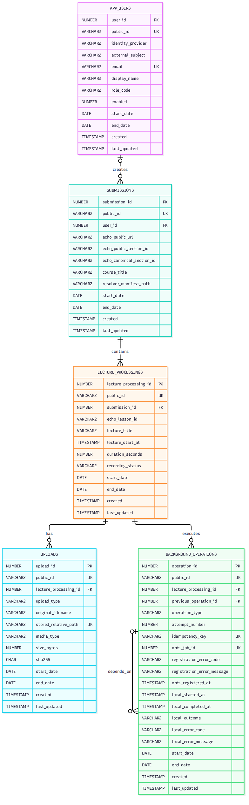
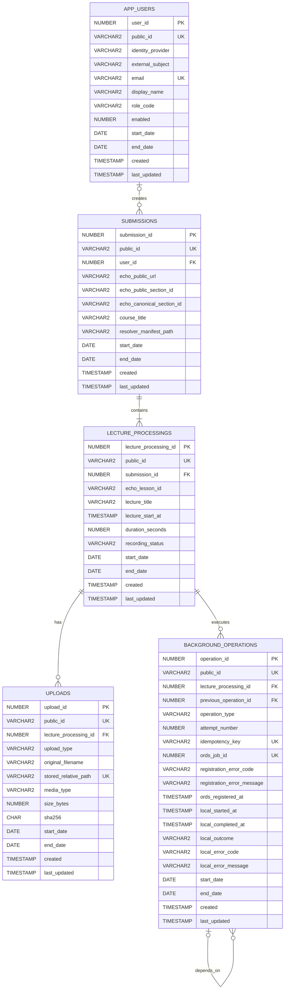

# TTU loengutranskriptsiooni rakenduse ERD

## 1. Dokumendi päritolu

Koostaja: AI (OpenAI Codex) kasutaja 3.–4.11.2026 kinnitatud MVP3 arhitektuuri, ligipääsureeglite, projekti olemasoleva töötlusmootori ning serveriülese ORDS-i järjekorra lepingu põhjal.

## 2. Sisukord

- [3. Eesmärk ja piirid](#3-eesmärk-ja-piirid)
- [4. Mermaid ER-diagramm](#4-mermaid-er-diagramm)
- [5. Tabelid ja veerud](#5-tabelid-ja-veerud)
- [6. Seosed ja terviklusreeglid](#6-seosed-ja-terviklusreeglid)
- [7. ORDS-i ja rakenduse oleku piir](#7-ords-i-ja-rakenduse-oleku-piir)
- [8. Failide reeglid](#8-failide-reeglid)
- [9. Kasutajad ja ligipääs](#9-kasutajad-ja-ligipääs)
- [10. Aeg, kustutamine ja audit](#10-aeg-kustutamine-ja-audit)
- [11. Oracle'i teostus](#11-oracle-i-teostus)

## 3. Eesmärk ja piirid

Andmemudel säilitab FastAPI veebirakenduse ja püsiva workeri ühise rakendusoleku:

- kasutaja identiteedi ja rakenduserolli;
- ühe kasutajategevusega esitatud loengute grupi;
- iga valitud Echo360 loengu töötluse;
- loenguga seotud valikulise slaidifaili metaandmed;
- rakenduse taustatöö toimingu seose ORDS-i keskse `job_id` väärtusega;
- rakenduse sisemise täitmise diagnostika.

Andmemudel ei ole tööjärjekord. See ei sisalda järjekorranumbrit ega ORDS-i töö hetkestaatuse kohalikku koopiat. ORDS on ainus järjekorra, sõltuvuste, claim'i ja täitmisoleku autoriteet.

Audio-, video-, PPT-, PPTX-, PDF-, transkripti-, slaidipildi-, mudeli- ja logifailide sisu ei salvestata Oracle'isse. Andmebaasis hoitakse ainult turvalisi suhtelisi failiviiteid, kontrollsummasid ja metaandmeid.

## 4. Mermaid ER-diagramm

[](erd.png)

Pildil klõpsamine avab täissuuruses PNG-versiooni. Pilt on genereeritud allolevast Mermaid-lähtekoodist.



## 5. Tabelid ja veerud

### 5.1. `APP_USERS`

Providerineutraalne rakenduse kasutaja. Tabel ei määra, kas hilisem autentimine kasutab Google'it, muud OIDC pakkujat või teist lahendust.

| Veerg | Oracle'i tüüp | Null | Reegel / tähendus |
|---|---|---:|---|
| `user_id` | `NUMBER(19)` | ei | Tehniline primaarvõti sequence'ist |
| `public_id` | `VARCHAR2(36 CHAR)` | ei | Avalikus API-s kasutatav UUID, unikaalne |
| `identity_provider` | `VARCHAR2(100 CHAR)` | jah | Autentimispakkuja püsiv kood |
| `external_subject` | `VARCHAR2(255 CHAR)` | jah | Autentimispakkuja stabiilne kasutajatunnus |
| `email` | `VARCHAR2(320 CHAR)` | jah | Normaliseeritud e-post, unikaalne, kui väärtustatud |
| `display_name` | `VARCHAR2(250 CHAR)` | jah | Kasutajale kuvatav nimi |
| `role_code` | `VARCHAR2(30 CHAR)` | ei | Rakenduseroll, algväärtused `USER` ja `ADMIN` |
| `enabled` | `NUMBER(1)` | ei | `1` lubatud, `0` keelatud |
| `start_date` | `DATE` | ei | Kehtivuse algus; vaikimisi `SYSDATE` |
| `end_date` | `DATE` | jah | Sulgemise aeg; füüsilist kustutamist ei kasutata |
| `created` | `TIMESTAMP` | ei | Loomise aeg; vaikimisi `SYSTIMESTAMP` |
| `last_updated` | `TIMESTAMP` | jah | Viimase muutmise aeg; API määrab muutmisel |

### 5.2. `SUBMISSIONS`

Üks kasutaja kinnitatud mitme loengu esitamine ühe Echo360 avaliku kogumiku põhjal.

| Veerg | Oracle'i tüüp | Null | Reegel / tähendus |
|---|---|---:|---|
| `submission_id` | `NUMBER(19)` | ei | Tehniline primaarvõti sequence'ist |
| `public_id` | `VARCHAR2(36 CHAR)` | ei | Submission'i päringu UUID; sama vormi kordusesitamise võti, unikaalne |
| `user_id` | `NUMBER(19)` | jah | Viide `APP_USERS` reale; jääb nullable'iks kuni autentimisviis kinnitatakse |
| `echo_public_url` | `VARCHAR2(2000 CHAR)` | ei | Kasutaja sisestatud valideeritud Echo360 `/public` URL |
| `echo_public_section_id` | `VARCHAR2(36 CHAR)` | ei | Avaliku sektsiooni UUID |
| `echo_canonical_section_id` | `VARCHAR2(36 CHAR)` | ei | Echo360 kanoonilise sektsiooni UUID |
| `course_title` | `VARCHAR2(500 CHAR)` | jah | Lahendamise hetkel saadud kursuse nimi |
| `resolver_manifest_path` | `VARCHAR2(1000 CHAR)` | ei | Runtime-juure suhteline tee resolveri JSON-manifestini |
| `start_date` | `DATE` | ei | Kehtivuse algus; vaikimisi `SYSDATE` |
| `end_date` | `DATE` | jah | Sulgemise aeg; füüsilist kustutamist ei kasutata |
| `created` | `TIMESTAMP` | ei | Loomise aeg; vaikimisi `SYSTIMESTAMP` |
| `last_updated` | `TIMESTAMP` | jah | Viimase muutmise aeg; API määrab muutmisel |

### 5.3. `LECTURE_PROCESSINGS`

Üks kasutaja valitud loeng ja selle terviklik rakenduse töötluskontekst. Kasutajale kuvatav koondolek tuletatakse selle rea ORDS-i toimingutest ja fikseeritud kataloogistruktuuri väljunditest; koondolekut tabelis ei säilitata.

| Veerg | Oracle'i tüüp | Null | Reegel / tähendus |
|---|---|---:|---|
| `lecture_processing_id` | `NUMBER(19)` | ei | Tehniline primaarvõti sequence'ist |
| `public_id` | `VARCHAR2(36 CHAR)` | jah | Avaliku read-only jagamislingi UUID, unikaalne; `NULL` tähendab, et loengut ei saa avaliku lingiga jagada |
| `submission_id` | `NUMBER(19)` | ei | Viide `SUBMISSIONS` reale |
| `echo_lesson_id` | `VARCHAR2(1000 CHAR)` | ei | Echo360 loengu identifikaator; võib olla UUID või Echo360 liit-ID |
| `lecture_title` | `VARCHAR2(500 CHAR)` | jah | Loengu nimi lahendamise hetkel |
| `lecture_start_at` | `TIMESTAMP` | jah | Echo360 loengu algusaeg UTC-s |
| `duration_seconds` | `NUMBER(12,3)` | jah | Salvestise kestus sekundites |
| `recording_status` | `VARCHAR2(30 CHAR)` | ei | Echo360 lahendamise hetke olek: `available`, `processing`, `failed` või `not_available` |
| `start_date` | `DATE` | ei | Kehtivuse algus; vaikimisi `SYSDATE` |
| `end_date` | `DATE` | jah | Sulgemise aeg; füüsilist kustutamist ei kasutata |
| `created` | `TIMESTAMP` | ei | Loomise aeg; vaikimisi `SYSTIMESTAMP` |
| `last_updated` | `TIMESTAMP` | jah | Viimase muutmise aeg; API määrab muutmisel |

### 5.4. `UPLOADS`

Kasutaja üleslaaditud faili metaandmed. MVP3 lubatud `upload_type` on `SLIDES`; faili sisu asub failisüsteemis.

| Veerg | Oracle'i tüüp | Null | Reegel / tähendus |
|---|---|---:|---|
| `upload_id` | `NUMBER(19)` | ei | Tehniline primaarvõti sequence'ist |
| `public_id` | `VARCHAR2(36 CHAR)` | ei | Avalik UUID, unikaalne |
| `lecture_processing_id` | `NUMBER(19)` | ei | Viide loengutöötlusele |
| `upload_type` | `VARCHAR2(30 CHAR)` | ei | MVP3-s `SLIDES` |
| `original_filename` | `VARCHAR2(500 CHAR)` | ei | Kasutaja faili kuva- ja auditnimi, mitte failisüsteemitee |
| `stored_relative_path` | `VARCHAR2(1000 CHAR)` | ei | Rakenduse input-juure suhteline turvaline tee, unikaalne |
| `media_type` | `VARCHAR2(255 CHAR)` | ei | Valideeritud MIME-tüüp |
| `size_bytes` | `NUMBER(19)` | jah | Faili suurus baitides, kui see on teada |
| `sha256` | `CHAR(64 CHAR)` | jah | Faili SHA-256 kuueteistkümnendkujul, kui see on arvutatud |
| `start_date` | `DATE` | ei | Kehtivuse algus; vaikimisi `SYSDATE` |
| `end_date` | `DATE` | jah | Sulgemise aeg; füüsilist kustutamist ei kasutata |
| `created` | `TIMESTAMP` | ei | Loomise aeg; vaikimisi `SYSTIMESTAMP` |
| `last_updated` | `TIMESTAMP` | jah | Viimase muutmise aeg; API määrab muutmisel |

### 5.5. `BACKGROUND_OPERATIONS`

Rakenduse üks ASR-i või slaiditöötluse toiming ja selle seos ORDS-i tööga. Tabel ei ole kohalik järjekord.

| Veerg | Oracle'i tüüp | Null | Reegel / tähendus |
|---|---|---:|---|
| `operation_id` | `NUMBER(19)` | ei | Tehniline primaarvõti sequence'ist |
| `public_id` | `VARCHAR2(36 CHAR)` | ei | Avalik UUID, unikaalne |
| `lecture_processing_id` | `NUMBER(19)` | ei | Viide loengutöötlusele |
| `previous_operation_id` | `NUMBER(19)` | jah | Slaiditöö puhul sama loengu ASR-i toiming; ASR-i puhul `NULL` |
| `operation_type` | `VARCHAR2(20 CHAR)` | ei | `ASR` või `SLIDES` |
| `attempt_number` | `NUMBER(9)` | ei | Sama loengu ja toiminguliigi kasutaja algatatud katse number alates ühest |
| `idempotency_key` | `VARCHAR2(250 CHAR)` | ei | ORDS-ile saadetud korduskindluse võti, unikaalne |
| `ords_job_id` | `NUMBER(19)` | jah | ORDS-i tagastatud keskne ID, unikaalne; välisviide, mitte FK |
| `registration_error_code` | `VARCHAR2(100 CHAR)` | jah | ORDS-i esitamisvea masinloetav kood |
| `registration_error_message` | `VARCHAR2(2000 CHAR)` | jah | Saladusteta esitamisvea diagnostika |
| `ords_registered_at` | `TIMESTAMP` | jah | ORDS-i `job_id` eduka sidumise aeg UTC-s |
| `local_started_at` | `TIMESTAMP` | jah | Rakenduse adapteri tegelik algusaeg pärast claim'i |
| `local_completed_at` | `TIMESTAMP` | jah | Rakenduse adapteri lõppaeg UTC-s |
| `local_outcome` | `VARCHAR2(30 CHAR)` | jah | Rakenduse kohalik tulemus: `SUCCEEDED`, `FAILED`, `INTERRUPTED` või `UNKNOWN` |
| `local_error_code` | `VARCHAR2(100 CHAR)` | jah | Rakenduse sisemise vea stabiilne kood |
| `local_error_message` | `VARCHAR2(2000 CHAR)` | jah | Saladusteta rakenduse diagnostika |
| `start_date` | `DATE` | ei | Kehtivuse algus; vaikimisi `SYSDATE` |
| `end_date` | `DATE` | jah | Sulgemise aeg; füüsilist kustutamist ei kasutata |
| `created` | `TIMESTAMP` | ei | Loomise aeg; vaikimisi `SYSTIMESTAMP` |
| `last_updated` | `TIMESTAMP` | jah | Viimase muutmise aeg; API määrab muutmisel |

## 6. Seosed ja terviklusreeglid

1. Üks `SUBMISSIONS` rida sisaldab vähemalt üht `LECTURE_PROCESSINGS` rida.
2. `APP_USERS.enabled` väärtus on `0` või `1`; see on ainus SQL-i `CHECK`-piirang.
3. `(identity_provider, external_subject)` on unikaalne.
4. `LECTURE_PROCESSINGS.public_id` on nullable ja unikaalne. Väärtustatud UUID lubab avaliku read-only transkriptilingi; `NULL` keelab avaliku lingiga jagamise. Rakenduse teenusekiht lubab väärtuse määrata alles pärast slaididega ühendatud Markdowni valmimist.
5. `(submission_id, echo_lesson_id)` on unikaalne: sama loengut ei lisata samasse esitamise gruppi kaks korda.
6. Ühel loengutöötlusel võib olla mitu ajaloolist üleslaadimist, kuid korraga kõige rohkem üks aktiivne `SLIDES` fail. See reegel jõustatakse funktsioonipõhise unikaalse indeksiga, mis arvestab `end_date IS NULL` tingimust.
7. `(lecture_processing_id, operation_type, attempt_number)` on unikaalne.
8. Väärtustatud `previous_operation_id` peab viitama sama loengu toimingule. Skeem kasutab selle jõustamiseks komposiitset unikaalsust `(lecture_processing_id, operation_id)` ja komposiitset võõrvõtit.
9. `SLIDES` töö ORDS-i `previous_job_id` võetakse sama loengu ASR-i toimingu `ords_job_id` väärtusest; seda ei hoita eraldi dubleeriva veeruna.
10. `ords_job_id` ei ole kohaliku skeemi võõrvõti, sest ORDS-i järjekord asub eraldi skeemi ja HTTP API taga.
11. Kõik väärtustatud `public_id`, `idempotency_key`, ORDS-i ID-d ja failiteed on muutumatud pärast edukat registreerimist.

## 7. ORDS-i ja rakenduse oleku piir

`BACKGROUND_OPERATIONS` ei sisalda veerge `queue_order` ega `ords_status`. Kasutajaliides küsib töö autoriteetse oleku ORDS-i API-st `ords_job_id` järgi.

Rakenduse kohalikud väljad tähendavad ainult järgmist:

- `ords_job_id` olemasolu näitab, et toiming on ORDS-i tööga seotud;
- `local_started_at` ja `local_completed_at` kirjeldavad rakenduse adapteri tegelikku protsessi;
- `local_outcome` ja `local_error_*` kirjeldavad rakenduse sisemist tulemust ning diagnostikat;
- fikseeritud kataloogistruktuuri manifestid tõendavad, millised püsivad väljundid rakendus tegelikult lõi.

Need väljad ei anna tööle käivitamisõigust. Worker käivitab toimingu ainult kehtiva ORDS-i claim'i ja `execution_token` alusel. `execution_token` on ajutine volitus ning seda ei salvestata rakenduse püsivasse andmebaasi.

## 8. Failide reeglid

- Andmebaasi salvestatakse ainult rakenduse määratud runtime-juure suhtelised teed.
- Kasutaja failinime ei kasutata salvestustee moodustamiseks.
- Absoluutseid hostiteid, `..` teeosi, signeeritud Echo360 URL-i päringuosi ega saladusi ei salvestata.
- `UPLOADS` kirjeldab kasutaja sisendfaili.
- Rakenduse väljundid asuvad fikseeritud kataloogistruktuuris ning neid kirjeldavad olemasolevad `run.json`, `transcript.json` ja `slides.json` manifestid; väljundfaile andmebaasis eraldi ei registreerita.
- Ajutine audio, video, teisendatud PDF ja proovikaadrid jäävad ainult runtime'i `work/` kataloogi.
- Faili eemaldamisel säilib auditkirje ja väärtustatakse `end_date`; sama suhtelist teed uuesti ei kasutata.

## 9. Kasutajad ja ligipääs

`APP_USERS` hoiab Google OAuthiga sisse loginud rakenduse kasutaja identiteeti ja rolli, kuid ei hoia parooli. `identity_provider` väärtus on `GOOGLE` ning `external_subject` sisaldab Google'i stabiilset `sub` tunnust. Esmakordsel sisselogimisel luuakse lubatud `USER` rolliga kasutaja; `ADMIN` roll määratakse otse andmebaasis.

Sisselogitud `USER` näeb kõiki aktiivseid loengutöid ja võib nende valmis Markdown-tulemusi alla laadida, kuid ei või uusi töid esitada, avalikke linke muuta ega loenguid sulgeda. `ADMIN` näeb kõiki kirjeid, esitab töid, haldab avalikke linke ja võib konkreetse loengutöötluse soft delete'iga sulgeda. Ligipääsureegel jõustatakse FastAPI teenusekihis; Oracle'i otseühendus ei ole brauserile avalik.

Rakendus kasutab üht Oracle'i skeemikasutajat ja `python-oracledb` ühenduste pooli. ORDS-i järjekorra API kasutab rakendusepõhist OAuth `client_credentials` klienti; kliendi ID ja saladus on rakenduse `.env` failis ning neid ei kasutata rakenduse skeemi otseühenduseks. OAuthi access tokenit hoitakse ainult rakenduse mälus.

`LECTURE_PROCESSINGS.public_id` on eraldi avaliku read-only jagamise tunnus. Kui väärtus on `NULL`, ei ole loeng avaliku lingiga kättesaadav. Teenusekiht lubab väärtuse määrata ainult siis, kui `slides/transcript_with_slides.md` on olemas. Väärtustatud UUID korral avaldab FastAPI selle slaididega ühendatud Markdown-tulemuse aadressil `/public/<public_id>/download`; aadress ei väljasta toortranskripti, ei kuva tööde nimekirja ega luba kirjutamistoiminguid.

## 10. Aeg, kustutamine ja audit

### Aja autoriteetsus ja ajavööndid

- Oracle’i andmebaasi autoriteetne aeg on UTC.
- Andmebaasi loodud ja API kaudu loetavad ajatemplid käsitletakse UTC-ajadena.
- API edastab ajad üheselt UTC-na, kasutades ISO 8601 vormingut ja `Z`-tähist.
- Brauser teisendab kuvatavad ajad kasutaja lokaalsesse ajavööndisse.
- Äriloogika ja ajalised võrdlused lähtuvad UTC-ajateljest.

### Kustutamine ja audit

Kõigil tabelitel on lisaks domeeniveergudele järgmised ühised veerud:

| Veerg | Tüüp | Reegel / tähendus |
|---|---|---|
| `start_date` | `DATE` | Kehtivuse algus; vaikimisi `SYSDATE` |
| `end_date` | `DATE` | Sulgemise aeg; füüsilist kustutamist ei kasutata |
| `created` | `TIMESTAMP` | Loomise aeg; vaikimisi `SYSTIMESTAMP` |
| `last_updated` | `TIMESTAMP` | Muutmise aeg; API määrab muutmisel |

Aktiivne kirje vastab tingimusele:

```sql
end_date IS NULL
```

Suletud kirjed ei tohi tavavoogudes ega tavakasutaja päringutes nähtavale jääda. Füüsilist kustutamist ei kasutata; kirje sulgemisel määratakse `end_date` ja `last_updated`.

- Loengutöötlusi ja toiminguid tavavoo kaudu füüsiliselt ei kustutata.
- Administraatori loengu kustutamistoiming sulgeb ainult valitud `LECTURE_PROCESSINGS` rea, määrates selle `end_date` ja `last_updated`; sama submission'i teised loengud ja submission ise jäävad aktiivseks.
- Sisendfaili eemaldamine märgitakse vastava `UPLOADS` kirje `end_date` väärtusega.
- Kasutaja blokeerimine muudab `APP_USERS.enabled` väärtuseks `0`; ajaloolised seosed säilivad.
- E-posti või kuvatava nime muutmine ei muuda varasemate tööde omanikku.

## 11. Oracle'i teostus

- Igal tabelil on oma Oracle sequence; ID määratakse `DEFAULT <sequence>.NEXTVAL` abil.
- Kõik FK-d, unikaalsused, `enabled` välja kontrollpiirang ja vajalikud indeksid luuakse versioonitud SQL-migratsioonidega kataloogis `db/schema/`.
- FastAPI ja worker kasutavad sama rakenduse skeemi, kuid lühikesi tehinguid ja `python-oracledb` ühenduste pooli.
- Pikka ASR-i või slaiditöötluse protsessi ei käivitata avatud andmebaasitehingu sees.
- Skeemi migratsioonide tegelik rakendamine muudab andmestruktuuri ja vajab kasutaja eraldi luba.
